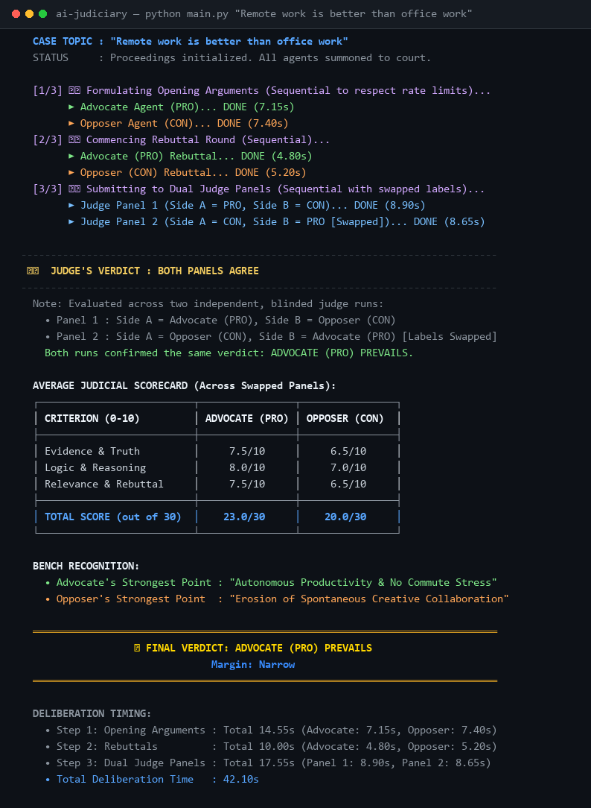

# ⚖️ AI Judiciary

A courtroom-style debate between AI agents. Give it any claim. One agent argues for it, one argues against it, they rebut each other, and a **blinded judge** delivers a verdict.



## How it works

1. **Advocate** argues *for* the claim (3 arguments, each with reasoning and evidence).
2. **Opposer** argues *against* it (3 arguments).
3. **Rebuttal round:** each side attacks the other's strongest point.
4. **Dual judge panels:** the judge sees the debate as anonymous "Side A" and "Side B", and runs **twice with the labels swapped**.
5. If both panels pick the same side, that's the verdict (with averaged scores). If they disagree, it's reported as a split decision.

All agents return strict JSON, which the app parses and retries if malformed.

## Design decisions

- **Blinded judge:** the judge never sees "pro" or "con", only randomised Side A/B labels, to avoid position and order bias.
- **Swap test:** running the judge twice with swapped labels checks that the verdict doesn't depend on which side was labelled A.
- **Honesty rules:** debaters must not invent statistics. If their side is factually weak, they argue the strongest honest version instead of stating falsehoods.
- **Calibrated scoring:** the judge scores evidence, logic and relevance from 0 to 10, with anchors and a required comparison per criterion, so it can't hand out identical scores to avoid choosing.
- **Rate-limit aware:** calls run sequentially with retry and backoff, so it works on a free API tier.

## Results

| Claim | Winner | Pro vs Con (/30) | Panels agree | Time |
|---|---|---|---|---|
| The Earth is flat | Con | 10 vs 27 | Yes | 17.6s |
| Vaccines cause autism | Con | 8.5 vs 27 | Yes | 15.7s |
| Remote work is better than office work | Pro | 23 vs 20 | Yes | 17.5s |
| Homework should be banned | Pro | 22.5 vs 20.5 | Yes | 16.2s |

The judge gives decisive margins on false claims and narrow margins on genuinely debatable ones.

## Limitations

- **The judge can't verify sources.** A side that names a specific study can score higher than one that speaks generally, even if the citation is wrong. Treat scores as a judgment of argument quality, not truth.
- **Small test set.** Four claims show consistency, not accuracy.
- **LLM judges are imperfect.** The swap test reduces position bias but doesn't remove other biases (e.g. preferring confident or detailed answers).

## Setup

```bash
git clone https://github.com/sibirajan777/ai-judiciary.git
cd ai-judiciary
python -m venv venv
venv\Scripts\activate        # Windows (macOS/Linux: source venv/bin/activate)
pip install -r requirements.txt
cp .env.example .env         # Windows: Copy-Item .env.example .env
```

Add your API key to `.env` (see `.env.example` for the options), then run:

```bash
python main.py "Remote work is better than office work"
```

## New Features

### Configuration Validation
- Validates API keys at startup before running debate
- Clear error messages for missing or placeholder keys

### Result Persistence
- Debate results automatically saved to `results/` directory as JSON
- Includes full debate transcript, scores, and timing data
- Files named with timestamp and claim for easy retrieval

### Configurable Timeouts
All timeouts configurable via `.env`:
```bash
LLM_CONNECT_TIMEOUT=15.0      # Connection timeout (seconds)
LLM_READ_TIMEOUT=90.0         # Read timeout (seconds)
LLM_MAX_RETRIES=3             # Max retry attempts
LLM_RATE_LIMIT_BACKOFF=10.0   # Base backoff for rate limits
```

### Robust JSON Parsing
- Handles multiple code fence formats
- Recovers from common JSON syntax errors (trailing commas, missing quotes)
- Multiple fallback parsing strategies

### Comprehensive Test Suite
- 46 unit tests covering JSON parsing, schema validation, and configuration
- Run with: `python -m pytest tests/ -v`

### Async Support (Experimental)
- Parallel LLM calls via `call_llm_async()` for faster execution
- Requires `aiohttp` (included in requirements.txt)
- Example in `examples/parallel_debate.py`

## Project structure

```
main.py              # runs the debate flow and prints results
agents.py            # advocate, opposer, rebuttal and judge logic
prompts.py           # all system prompts (edit these to tune behaviour)
llm.py               # LLM calls, retries, timeouts, rate-limit handling
tests/               # unit tests
  test_json_parsing.py
  test_main.py
  test_llm_config.py
  conftest.py
examples/            # usage examples
  parallel_debate.py
results/             # saved debate results (auto-created)
pytest.ini           # test configuration
```

## Built with

Python, Gemini API, and Google Antigravity IDE.

## Ideas for next steps

- Larger evaluation set with expected outcomes
- Web UI (Streamlit)
- Multiple judge models voting
